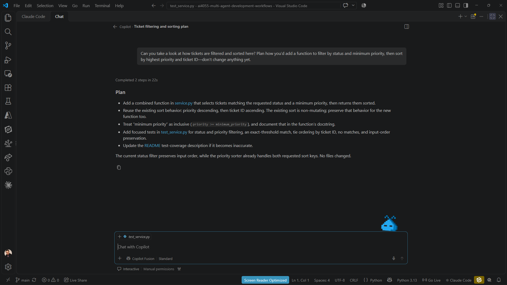

# Lab 1: Inspect the project and plan before editing

**Suggested duration:** 25 minutes

## Objective

Use Agent Mode to explore an unfamiliar Python workspace and produce an evidence-backed plan without changing files.

## Setup

1. Open the repository root in VS Code.
2. Open a terminal in `demos/module-1-python/`.
3. Run the baseline tests:

   ```console
   python -m unittest discover -s tests -v
   ```

   Confirm that the tests pass before asking Copilot to change anything.

## Task

Start a new Agent Mode conversation. Ask it to:

- Trace how a ticket is represented and how the service filters and sorts tickets.
- Name the files and tests that support its explanation.
- Propose a multi-file refactor that adds one `find_tickets` operation with optional status and minimum-priority filters, ordered by descending priority and then ticket ID.
- List acceptance criteria, tests to add, and assumptions.
- Stop without editing files or running commands.

Use repository search and inspect the named source files yourself. Treat the response as a proposal, not proof.

## Example plan output

This screenshot shows one possible evidence-backed plan. Your response may differ; verify it against the repository yourself.



## Individual practice

Repeat the task in a fresh chat, changing the minimum priority or filter to a different reasonable value. Compare whether the proposed tests change. Do not edit the files during this lab.

**Stretch:** Ask a second agent to independently find callers/tests. Reconcile the evidence yourself; the reviewer must not modify files.

## Deliverable

Save or capture the plan. Check that it cites real files, preserves the existing helper behavior, and identifies test cases for filters, order, ties, empty input, and input immutability.

## Debrief

Which claims were directly supported by code? Which were assumptions? Did the agent discover every relevant caller? Note one missing piece of context you would attach before implementation.
