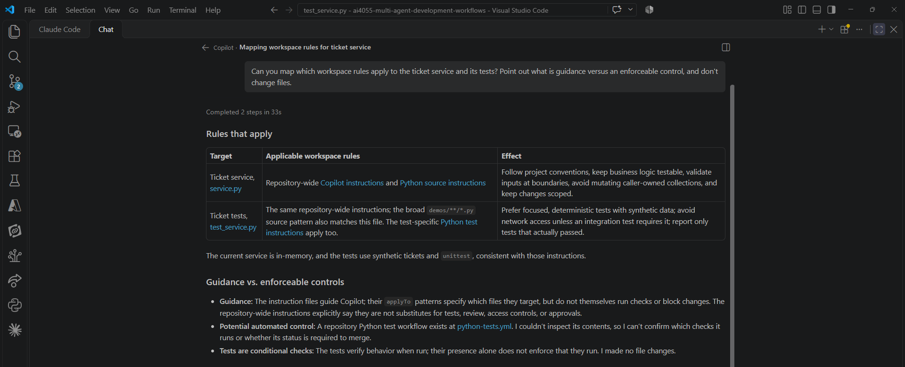

# Lab 1: Map instruction scope

**Time:** 30 minutes · **Mode:** pairs

## Goal

Decide which constraints belong in repository-wide instructions, path-specific instructions, custom-agent role instructions, or a one-time task prompt.

## Try it

Open the repository root in VS Code. Inspect:

- `.github/copilot-instructions.md`
- `.github/instructions/python-source.instructions.md`
- `.github/instructions/python-tests.instructions.md`
- `.github/agents/python-reviewer.agent.md`
- `.github/prompts/08-refactor-plan.prompt.md`

Classify each rule in this worksheet:

| Example rule | Intended scope | Why? |
|---|---|---|
| Never commit secrets |  |  |
| Use parameterized SQL in the database adapter |  |  |
| Review only; do not modify files |  |  |
| For this change, preserve the current public function signature |  |  |

Ask Copilot to explain which instructions it considers applicable to `demos/module-1-python/customer_ops/service.py` and `tests/test_service.py`. Inspect the source files and files referenced by the agent; do not treat the model's explanation as authoritative proof of instruction loading.

## Example response

The example distinguishes guidance from checks that only run when invoked. Verify the paths and workflow status in your own workspace.

## Individual extension

Add one proposed rule for a new module, then decide the narrowest scope that still makes it reusable. Identify one rule that should be enforced outside the prompt (for example, through CI or repository permissions).

## Evidence

Submit the completed classification table, the files you inspected, and one paragraph describing what instruction files can guide versus what only platform controls can enforce.
