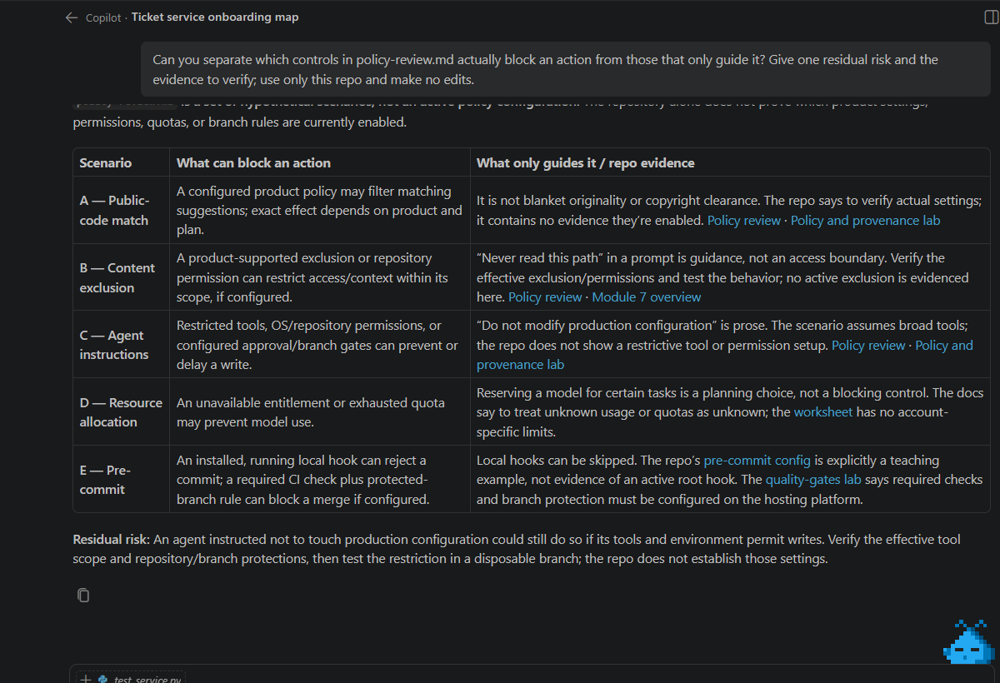

# Lab 1: Policy and code provenance

**Time:** 30 minutes · **Mode:** facilitated case review

## Objective

Separate product/organization policy from repository guidance and from review obligations.

## Steps

1. Read Scenarios A–C in `demos/module-7-governance/policy-review.md`.
2. For each, fill in: policy owner, scope, enforcement point, verification evidence, and residual risk.
3. Check the current public-code matching and content-exclusion documentation for the actual training product/plan. Record the URL and date checked; do not assume settings guarantee originality or act as blanket legal clearance.
4. Compare an agent instruction (“do not read this path”) with a product-supported content exclusion or repository permission. Identify which is enforceable and how to verify it.
5. Add a case where generated code contains an unlicensed or unattributed dependency. Propose a human review and dependency/license checking step.

## Discussion prompt

An agent file says “do not modify production settings,” but the agent has terminal and edit tools. Which control must change if the action must be blocked rather than discouraged?

## Example control map

The scenarios are hypothetical; this example distinguishes configured enforcement from repository guidance and notes what remains unverified.

## Deliverable

Three completed control analyses, one correctly identified residual risk, and an evidence source for any product-policy claim.
