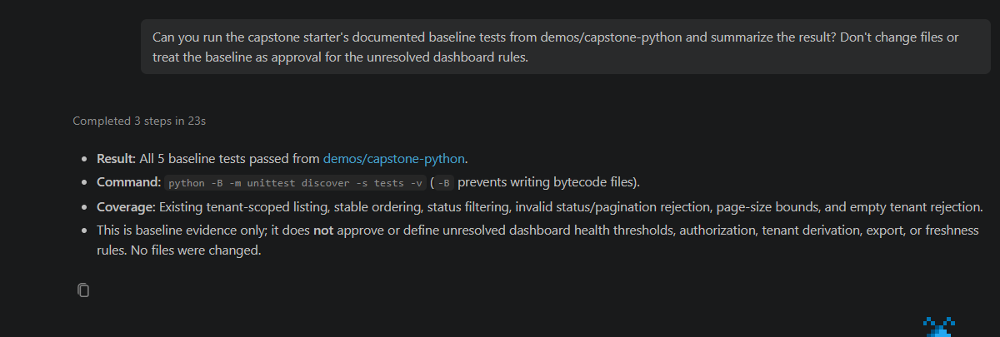

# Capstone Lab 3: Implement and verify

**Time:** 45 minutes · **Mode:** operator + QA reviewer

## Approved implementation slice

Choose one slice from the approved plan that does **not** depend on unresolved health thresholds or authorization policy. Good candidates include validating pagination, preserving tenant scoping, status filtering, or adding a summary over already authorized records.

## Steps

1. Confirm allowed files and acceptance criteria with the technical lead.
2. Implement in dependency order with small checkpoints.
3. Add focused tests, including empty results, invalid input, pagination bounds, and cross-tenant separation as applicable.
4. Run the exact documented command from `demos/capstone-python/`:

   ```console
   python -m unittest discover -s tests -v
   ```

5. Run the starter demo and inspect the complete diff. Separate failures caused by the change from environment or pre-existing issues.
6. Ask QA to map each accepted criterion to test evidence; do not claim unrun checks passed.

## Baseline test evidence

These five tests verify the starter only; they do not implement or approve the unresolved dashboard rules.



## Deliverable

Small reviewed diff, tests, command output, and a requirement-to-test trace. If a policy decision blocks implementation, record the blocker and demonstrate a non-sensitive independent slice instead.
